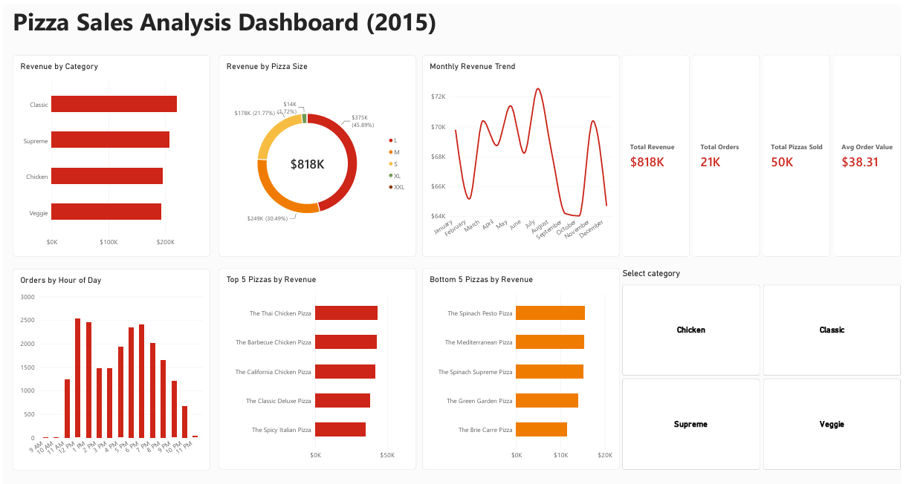

# 🍕 Pizza Sales Analysis Dashboard (Power BI)

Power BI dashboard analyzing one year (2015) of pizza restaurant sales.

## 📊 KPIs
- Total Revenue: **$817,860**
- Total Orders: **21,350**
- Pizzas Sold: **49,574**
- Avg Order Value: **$38.31**

## 🗂️ Dataset
- Kaggle "Pizza Place Sales" (4 CSV files: orders, order_details, pizzas, pizza_types)

## ⚙️ What I Did
- Imported and cleaned 4 tables in Power Query
- Built a data model with one-to-many relationships
- Created DAX measures (SUMX, RELATED, DISTINCTCOUNT, DIVIDE)
- Added calculated columns for order hour (12-hour format)
- Used Top N filters, a category slicer and a custom theme

## 💡 Key Insights
- **Classic** is the top category, but the top 3 pizzas are all **Chicken**
- **Large** size brings ~46% of revenue; XL and XXL less than 2%
- Peak hours: **12 to 1 PM** (lunch) and **5 to 6 PM** (dinner)
- **July** was the best month, **September/October** the weakest
- **Brie Carre** is the lowest selling pizza

## ✅ Recommendations
- More staff during lunch and dinner peaks
- Afternoon deals to boost slow hours (2 to 4 PM)
- Review XL/XXL sizes and the bottom 5 pizzas

## 🛠️ Tools
Power BI Desktop · Power Query · DAX
